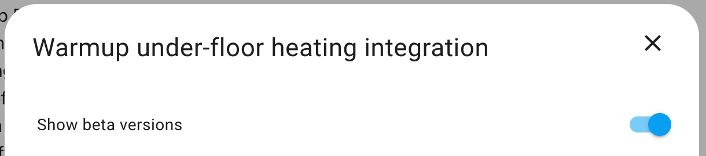
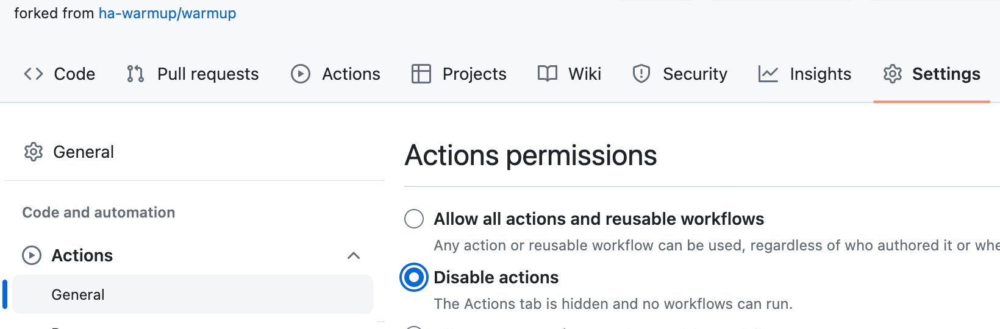

# Contributing

Thank you for your interest in helping out with this project.

In ascending order of complexity, here are ways you can get involved with this project:

* Issues
    * looking at [issues raised](https://github.com/ha-warmup/warmup/issues) and trying to advise users looking for help, or encouraging them to obtain useful diagnostics
* Documentation
    * increasing the detail, accuracy or readability in:
	    * our [documentation wiki](https://github.com/ha-warmup/warmup/wiki) (which you can edit directly) or 
	    * any of the readme files accompanying the code (which will require a pull request)
* Testing
	* when candidate fixes are posted against issues, you can load the modified code yourself and give it a go, to see if it works well under your own circumstances
* Coding (Development)
	* modifying the programme source code or configuration defaults in order to rectify reported issues, or to work on new features

## Testing

## Beta

If you are willing to help us test new features, 
before they are put on general release, 
you can set your HACS Integration (re-)download settings 
to `show beta versions`.



Please report any failure with specific messages or circumstance, in the relevant issue ticket. If you get none, then please report your success, so that we know we are closer to promoting the fix towards the main live release.

## Alpha testing

If you are suffering with a specific issue yourself, or are just happy to get involved in earlier testing, you can obtain earlier releases of code in different ways, depending on your setup.

Let's suppose that someone has submitted a Pull Request (PR) for a branch called `fix232_v2`, here are a couple of methods.

#### Alternative manual install

If you installed your set up manually, you can use the [alternative manual install method](https://github.com/ha-warmup/warmup?tab=readme-ov-file#alternative-versions) specifying the branch, e.g. 

```
git clone -b fix232_v2 https://github.com/ha-warmup/warmup.git /tmp/warmup
```

#### HACS install.service

You can install a specific branch on HASOS / HACS by calling the update.install service

```
service: update.install
data:
  version: fix232_v2
target:
  entity_id: update.warmup_under_floor_heating_integration_update
```

## Development

### Project Structure

For the time being, contributors have settled on a 
[project structure](https://github.com/ha-warmup/warmup/issues/50) 
that includes:

* HACS integration as a custom repository, with associated metadata files
* Instructions for manual install as custom_component
* incorporating any changes to the API-related python code in warmup4ie subfolder
	* and keeping a tracking copy in the root warmup4ie-PyPi folder for later

### Forking

As you will use a fork for your development we encourage you to 
familiarise yourself with the [Github guide to working with forks](https://help.github.com/en/github/collaborating-with-issues-and-pull-requests/working-with-forks).

If you Fork the project, it might tell you that 
workflows are being disabled on your fork. 
This is good, because they are currently 
designed only to work on the main fork, 
so you do NOT want to enable them. 
If, for any reason, your fork starts to notify you that 
you have Actions failing, then you should disable them: 



In your OWN fork:

* Settings / Actions / General
* Actions permissions = Disable
* remember to Save

Now the Actions tab should disappear from your fork, and the notifications will cease.

### Development practices

`master` is the only long-lived branch. Create a branch from the latest `master` for each change, keep it rebased onto `master` while you work, and keep each pull request to one change.

Please raise an issue if you want further guidance on developing new features or fixing issues.

### Pull Requests

Once you have completed your development and testing on your changes, raise a Pull Request against **`master`**. Add a line for your change under **Unreleased** in [CHANGELOG.md](CHANGELOG.md).

Every pull request runs these checks. If any of them fail, your Pull Request might be held back:

* **Tests**: ruff lint and format, and the pytest suite (see below)
* **Validate with hassfest** and **HACS validation**: Home Assistant and HACS repository checks
* **Version check**: `manifest.json` must hold a version newer than the latest release (see [Versioning](#versioning))

### Tests and linting

CI runs [ruff](https://docs.astral.sh/ruff/) and the pytest suite on every pull request. To run them locally with [uv](https://docs.astral.sh/uv/) and Python 3.14:

```sh
uv venv -p 3.14 && source .venv/bin/activate
uv pip install -r requirements_test.txt --override requirements_test_override.txt
ruff check . && ruff format --check .
python -m pytest
```

Use `python -m pytest` rather than `pytest`, so that `tests.ha_compat` can be imported.

## Release

We use GitHub Releases, both for a GitHub repo and for a [HACS integration](https://hacs.xyz/docs/publish/integration/#github-releases-optional). Releases are made from `master` once the changes merged there have been tested.

Before releasing, move the entries under **Unreleased** in [CHANGELOG.md](CHANGELOG.md) into a section for the new version. You could use `git log --oneline` to gather the info.

### Versioning

Since 2021.5.23, the versioning format has been YYYY.M.D (no leading zeroes). Note that HACS does not support the use of candidate suffixes - using a version like YYYY.M.D-beta may break the component. 

When releasing a version, please ensure that you update the version in 

```
custom_components/warmup/manifest.json
```

The Marketplace and HACS read the version from `manifest.json` at the release tag, so bump it before you tag. CI enforces this: a pull request fails until `manifest.json` holds a version newer than the latest release, and publishing a release fails the "Version check" workflow if the tag (without its `v`) doesn't match `manifest.json`.

Create the GitHub Release from `master`, tagged `v` followed by the version in `manifest.json` (for example `v2026.11.26`).

Please be clear if this is a Production release. 
Otherwise, when the Release is created 
it should be marked as a Pre-release. 
That way it will only be available to users who 
have selected the option 'show beta versions'. 

When community testing shows that a Prerelease is ready for mainstream use:
* in the main ha-warmup repository, go into [Code / Tags / Releases](https://github.com/ha-warmup/warmup/releases)
* find the Prerelease and Edit it
* remove mentions in the text of this being a Prerelease
* uncheck the box `Set as a pre-release`
* check the box `Set as the latest release`
* click Update Release
This should make that the target of https://github.com/ha-warmup/warmup/releases/latest and therefore the version that most HACS users will be updated to.
